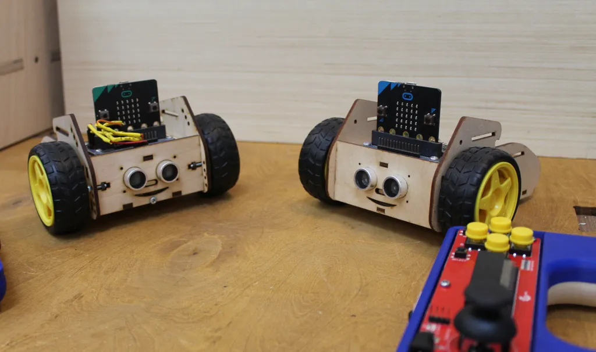
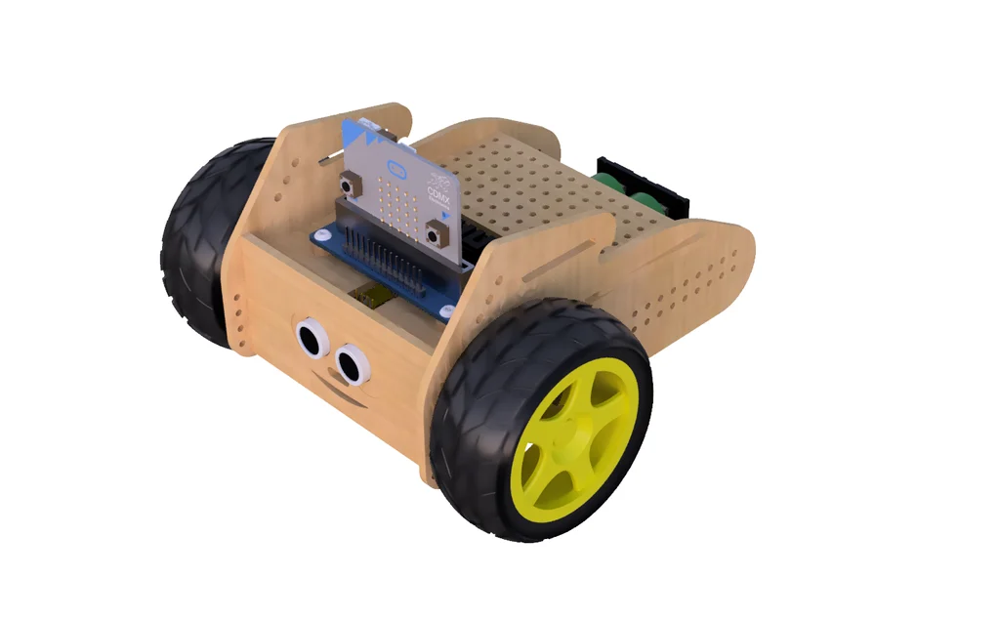

**English** | [Polski](README.pl.md)

# Borsuk (Badger) – a plywood robot for micro:bit



**Borsuk** (Polish for *badger*) is an educational robot laser-cut from 3 mm plywood and
controlled by a **BBC micro:bit** (V1 or V2). Motors and servos are driven by the
*Waveshare Motor Driver for micro:bit*, and obstacles are detected by an RCW-0001 ultrasonic
sensor. You can program the robot to drive on its own (e.g. obstacle avoidance) or drive it
with a **joystick remote**: a second micro:bit in a Keyestudio KS0296 joystick board,
connected over radio.

The robot was designed for robotics workshops for children at FabLab Gdańsk.

This repository has everything in one place:

| What | Where |
|---|---|
| **MakeCode** extension (blocks: robot + remote + radio), English + Polish | repository root: [`borsuk.ts`](borsuk.ts), [`pilot.ts`](pilot.ts), [`remote.ts`](remote.ts) |
| **MicroPython** library (same set of functions) | [`python/borsuk.py`](python/borsuk.py) |
| MakeCode examples | [`examples/makecode/`](examples/makecode/) |
| MicroPython examples | [`examples/micropython/`](examples/micropython/) |
| Laser-cut file (DXF) and preview | [`hardware/`](hardware/) |
| Robot STEP file, remote case STL | [MakerWorld](https://makerworld.com/en/models/2668556-badger-robot-for-micro-bit), [Printables](https://www.printables.com/model/40102-handle-joystick-for-microbit-module-from-keyestudi) |
| Documentation | [`docs/`](docs/) (Polish: [`docs/pl/`](docs/pl/)) |

## Robot versions

| | v1 | v2 |
|---|---|---|
| Drive | 2 × 360° servo (S0 = left, S1 = right) | 2 × geared DC motor (A = left, B = right) |
| Setting in code | `robot drive: 360° servos (v1)` | default, nothing to set |



## Quick start – MakeCode (blocks)

1. Open <https://makecode.microbit.org> and create a new project.
2. **Extensions** → paste `https://github.com/cyryllo/Borsuk` → choose *borsuk*.
3. Two categories appear: **Borsuk** (robot) and **Borsuk Remote** (joystick).
   With the editor language set to Polish, the blocks are in Polish.
4. First program (more in [examples/makecode](examples/makecode/README.md)):

   ```blocks
   input.onButtonPressed(Button.A, function () {
       borsuk.driveFor(BorsukMove.Forward, 50, 1000)
   })
   ```

5. Remote control – two micro:bits, one block each:

   | micro:bit in the **remote** | micro:bit in the **robot** |
   |---|---|
   | `send control to robot, radio group 1` | `receive remote control, radio group 1` |

   Every remote + robot pair in the room needs a **different radio group**.

More: [docs/makecode.md](docs/makecode.md).

## Quick start – MicroPython

1. Open <https://python.microbit.org>.
2. **Project → Open…** and add [`python/borsuk.py`](python/borsuk.py) (it will be copied to the micro:bit).
3. In `main.py`:

   ```python
   from borsuk import Robot, FORWARD
   robot = Robot()
   robot.drive_for(FORWARD, 50, 1000)
   ```

More: [docs/micropython.md](docs/micropython.md).

## Documentation

- [Hardware, wiring and assembly](docs/hardware.md)
- [MakeCode blocks – reference](docs/makecode.md)
- [MicroPython library](docs/micropython.md)
- [Radio remote control](docs/radio-remote.md)
- [Calibration and troubleshooting](docs/calibration-troubleshooting.md)
- [Migrating from the old repositories](docs/migration.md) · [Changelog](CHANGELOG.md)

## Development

```bash
# MakeCode extension
npm install -g pxt
pxt target microbit
pxt install
pxt build          # compiles the library + test.ts (V1 and V2)

# MicroPython library – tests on a computer (fake micro:bit modules)
cd python && python3 -m unittest discover -s tests -v

# DXF preview as SVG
python3 tools/dxf_preview.py hardware/Borsuk_v2.dxf hardware/Borsuk_v2_preview.svg

# block images of the examples (en + pl) – after pushing to GitHub
npm install --no-save playwright-core && npx playwright-core install chromium
node tools/render_blocks.mjs
```

Both test suites run automatically on GitHub Actions ([`.github/workflows/build.yml`](.github/workflows/build.yml)).

Block translations live in [`_locales/pl/`](_locales/pl/). After changing a block, regenerate the
keys with `pxt gendocs --locs` and update the Polish files.

## Origin

Created at FabLab Gdańsk. It merges the earlier repositories pxt-Borsuk, BorsukPY (this
repository, formerly under that name) and JoyStick – the history of all three is kept here.
They were based on [waveshare/pxt-Motor](https://github.com/waveshare/pxt-Motor) and
pxt-WSJoyStick by Waveshare.

## License

[MIT](LICENSE)
