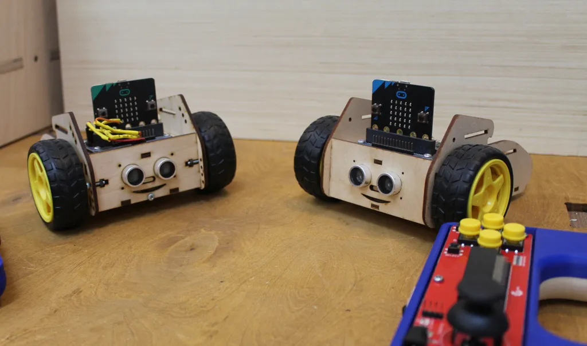
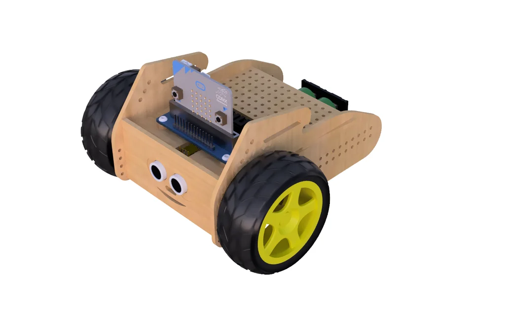

[English](README.md) | **Polski**

# Borsuk – robot ze sklejki na micro:bit



**Borsuk** (ang. *Badger*) to edukacyjny robot wycinany laserowo ze sklejki 3 mm, sterowany przez
**BBC micro:bit** (V1 lub V2). Napęd i serwa obsługuje płytka
*Waveshare Motor Driver for micro:bit*, a przeszkody wykrywa czujnik RCW-0001. Robotem można sterować programem
(jazda autonomiczna, omijanie przeszkód) albo zdalnie, **pilotem z joystickiem**
(drugi micro:bit w module Keyestudio KS0296 z joystickiem, połączenie radiowe).

To repozytorium łączy w jednym miejscu wszystko, czego potrzeba:

| Co | Gdzie |
|---|---|
| Rozszerzenie **MakeCode** (bloki: robot + pilot + radio) | katalog główny: [`borsuk.ts`](borsuk.ts), [`pilot.ts`](pilot.ts), [`remote.ts`](remote.ts) |
| Biblioteka **MicroPython** (ten sam zestaw funkcji) | [`python/borsuk.py`](python/borsuk.py) |
| Przykłady MakeCode | [`examples/makecode/`](examples/makecode/) |
| Przykłady MicroPython | [`examples/micropython/`](examples/micropython/) |
| Plik do wycinania (DXF) i podgląd | [`hardware/`](hardware/) |
| STEP robota, STL obudowy pilota | [MakerWorld](https://makerworld.com/en/models/2668556-badger-robot-for-micro-bit), [Printables](https://www.printables.com/model/40102-handle-joystick-for-microbit-module-from-keyestudi) |
| Dokumentacja | [`docs/`](docs/pl/) |

## Wersje robota

| | v1 | v2 |
|---|---|---|
| Napęd | 2 × serwo 360° (S0 = lewe, S1 = prawe) | 2 × silnik DC z przekładnią (A = lewy, B = prawy) |
| Ustawienie w kodzie | `napęd robota: serwa 360° (v1)` | domyślne, nic nie trzeba ustawiać |



## Szybki start – MakeCode (bloki)

1. Otwórz <https://makecode.microbit.org> i utwórz nowy projekt.
2. **Rozszerzenia** → wklej adres `https://github.com/cyryllo/Borsuk` → wybierz *borsuk*.
3. Pojawią się dwie kategorie: **Borsuk** (robot) i **Borsuk Pilot** (joystick).
4. Pierwszy program (więcej w [examples/makecode](examples/makecode/README.pl.md)):

   ```blocks
   input.onButtonPressed(Button.A, function () {
       borsuk.driveFor(BorsukMove.Forward, 50, 1000)
   })
   ```

5. Sterowanie pilotem – dwa micro:bity, każdy z jednym blokiem:

   | micro:bit w **pilocie** | micro:bit w **robocie** |
   |---|---|
   | `wysyłaj sterowanie do robota, grupa radiowa 1` | `odbieraj sterowanie z pilota, grupa radiowa 1` |

   Każda para pilot + robot w sali musi mieć **inną grupę radiową**.

Więcej: [docs/makecode.md](docs/pl/makecode.md).

## Szybki start – MicroPython

1. Otwórz <https://python.microbit.org>.
2. **Project → Open…** i dodaj plik [`python/borsuk.py`](python/borsuk.py) (zostanie dograny na micro:bit).
3. W `main.py`:

   ```python
   from borsuk import Robot, FORWARD
   robot = Robot()
   robot.drive_for(FORWARD, 50, 1000)
   ```

Więcej: [docs/micropython.md](docs/pl/micropython.md).

## Dokumentacja

- [Sprzęt, połączenia i budowa](docs/pl/sprzet.md)
- [Bloki MakeCode – opis wszystkich bloków](docs/pl/makecode.md)
- [Biblioteka MicroPython](docs/pl/micropython.md)
- [Sterowanie pilotem przez radio](docs/pl/sterowanie-radiowe.md)
- [Kalibracja i rozwiązywanie problemów](docs/pl/kalibracja-i-problemy.md)
- [Przejście ze starych repozytoriów](docs/pl/migracja.md) · [Lista zmian](CHANGELOG.pl.md)

## Rozwój

```bash
# rozszerzenie MakeCode
npm install -g pxt
pxt target microbit
pxt install
pxt build          # kompiluje bibliotekę + test.ts (V1 i V2)

# biblioteka MicroPython – testy na komputerze (atrapy modułów micro:bit)
cd python && python3 -m unittest discover -s tests -v

# podgląd pliku DXF jako SVG
python3 tools/dxf_preview.py hardware/Borsuk_v2.dxf hardware/Borsuk_v2_preview.svg

# obrazki bloków przykładów (en + pl) – po wypchnięciu na GitHub
npm install --no-save playwright-core && npx playwright-core install chromium
node tools/render_blocks.mjs
```

Oba zestawy testów uruchamia automatycznie GitHub Actions ([`.github/workflows/build.yml`](.github/workflows/build.yml)).

## Pochodzenie

Projekt powstał w FabLab Gdańsk. Łączy wcześniejsze repozytoria
pxt-Borsuk,
BorsukPY (to repozytorium, dawniej pod tą nazwą) i
JoyStick (historia wszystkich trzech jest zachowana tutaj), które z kolei bazowały na
[waveshare/pxt-Motor](https://github.com/waveshare/pxt-Motor) i
pxt-WSJoyStick firmy Waveshare.

## Licencja

[MIT](LICENSE)
