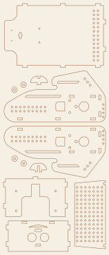
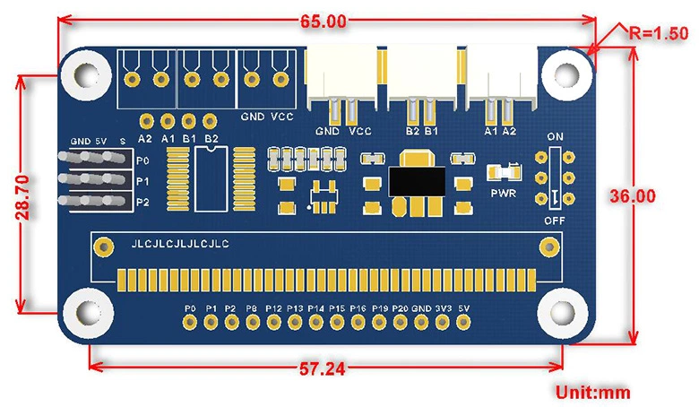
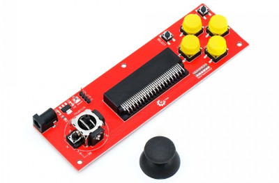

**English** | [Polski](pl/sprzet.md)

# Hardware, wiring and assembly

## Project files

- **MakerWorld** – *Badger* robot (Borsuk): <https://makerworld.com/en/models/2668556-badger-robot-for-micro-bit>
  (cutting files, STEP file for further development, remote case STL)
- **Printables** – remote case (Handle Joystick for micro:bit, Keyestudio):
  <https://www.printables.com/model/40102-handle-joystick-for-microbit-module-from-keyestudi>
- The v2 DXF is also in this repository: [`hardware/Borsuk_v2.dxf`](../hardware/Borsuk_v2.dxf)

## Parts list (robot v2)

| Part | Qty | Notes |
|---|---|---|
| 3 mm plywood | sheet min. 160 × 370 mm | laser cut, file [`Borsuk_v2.dxf`](../hardware/Borsuk_v2.dxf) |
| Wood glue | | to glue the body |
| BBC micro:bit V1 or V2 | 1 | V2 recommended (more memory, speaker) |
| Waveshare **Motor Driver for micro:bit** (SKU 15220) | 1 | 2 DC motor driver + 3 servo connectors, e.g. [Botland](https://botland.com.pl/microbit-rozszerzenia/13303-sterownik-2-silnikow-i-3-serwomechanizmow-i2c-dla-bbc-microbit-waveshare-15220-5904422320447.html) |
| Dual Shaft Gear Motor ("yellow TT") with wheel | 2 | v1: 2 × 360° servo |
| **RCW-0001** distance sensor | 1 | ultrasonic, TRIG/ECHO, works at 3.3 V |
| 2 × 18650 battery holder (series) | 1 | |
| 18650 Li-ion cell | 2 | about 7.4 V together |
| M3 × 25 screw | 4 | motor mounting |
| M3 × 10 screw | 4 | motor driver mounting |
| M3 nut | 4 | |
| Wires | | sensor ↔ driver board, power |

### Remote (optional)

| Part | Qty | Notes |
|---|---|---|
| BBC micro:bit V1 or V2 | 1 | a second micro:bit |
| **Keyestudio KS0296** Joystick Breakout Board for micro:bit | 1 | joystick + 6 buttons, DC jack 4.75–12 V |
| 3D-printed case | 1 | STL on Printables / MakerWorld (links above) |

## Cutting and assembly

- File: [`hardware/Borsuk_v2.dxf`](../hardware/Borsuk_v2.dxf), units **mm**, all parts on one
  **148 × 360 mm** sheet. Preview: [`hardware/Borsuk_v2_preview.svg`](../hardware/Borsuk_v2_preview.svg).
- Tab slots are **3 × 7 mm**, so the design is for **3 mm** plywood. For thicker/thinner
  plywood, scale the slots, not the whole drawing.
- Parts: 2 sides (with motor holes and rows of mounting holes), base, front with the
  "face" and sensor holes, back, perforated top plate, small parts (washers, clips).

More in [`hardware/README.md`](../hardware/README.md).

## Motor driver – Waveshare Motor Driver for micro:bit

Manufacturer docs: [Waveshare Wiki – Motor Driver for micro:bit](https://www.waveshare.com/wiki/Motor_Driver_for_micro:bit)

> **Beware of shop descriptions:** some shops (e.g. Botland) list an "I2C interface,
> 12-bit". That is wrong – there is no I2C chip on the manufacturer's schematic. The
> TB6612FNG is driven **directly by micro:bit pins**: PWMA = P8, AIN1 = P13, AIN2 = P12,
> PWMB = P16, BIN1 = P14, BIN2 = P15 (STBY tied to 3V3). This is how this library works.

| Parameter | Value |
|---|---|
| Power input (VIN terminal) | **6–12 V** (2 × 18650 = 7.4–8.4 V ✔) |
| Motor driver | TB6612FNG, 2 channels |
| Servo power | 5 V (5 V regulator, up to 3 A) |
| Logic / micro:bit | 3.3 V (RT9193 regulator – the board powers the micro:bit) |
| Mounting holes | Ø3 mm (M3 × 10 screws) |
| Dimensions | 65 × 36 mm, hole spacing 57.24 × 28.7 mm |

*Drawing: Waveshare. Dimensions in mm; Ø3 mm mounting holes spaced 57.24 × 28.7 mm.*

Board connectors:

| Connector | Description |
|---|---|
| VCC / GND (screw terminal or plug) | battery power, 6–12 V |
| A1 / A2 | motor A (left) |
| B1 / B2 | motor B (right) |
| S0 / S1 / S2 (side, GND / 5V / S) | 3-pin servo connectors: signal **P0 / P1 / P2**, **5 V** power |
| Bottom header | **P0 P1 P2 P8 P12 P13 P14 P15 P16 P19 P20 GND 3V3 5V** |
| ON / OFF | power switch, PWR LED |

Free pins on the bottom header (not used by the motors): **P0, P1, P2, P19, P20**,
plus **3V3** and **5V** power.

## Wiring – robot

The micro:bit plugs into the edge connector of the Waveshare driver. The pins are fixed:

| Function | micro:bit pin |
|---|---|
| Motor A (left) – PWM / IN1 / IN2 | P8 / P13 / P12 |
| Motor B (right) – PWM / IN1 / IN2 | P16 / P14 / P15 |
| Servo S0 (v1: left wheel) | P0 |
| Servo S1 (v1: right wheel) | P1 |
| Servo S2 (e.g. "head", gripper) | P2 |
| Distance sensor TRIG / ECHO | two free pins on the bottom header (P0, P1, P2, P19, P20); library default P1 / P2 |

Only P0, P1, P2, P19 and P20 are broken out as free pins on the driver. The other micro:bit
pins (P3–P7, P9–P11) are not available on the board – only via the micro:bit edge connector.

### RCW-0001 distance sensor

Borsuk uses the **RCW-0001** sensor: it works at 3.3 V, so it connects directly to the
micro:bit without a voltage divider. It has 4 pins: VCC, TRIG, ECHO, GND. Connect TRIG and
ECHO to free pins on the driver header and set the same pins in your program with the
`distance sensor TRIG … ECHO …` block (MicroPython: `robot.set_distance_sensor(trig, echo)`).

| RCW-0001 | Driver header |
|---|---|
| VCC | **3V3** |
| GND | GND |
| TRIG | a free pin, e.g. P1 |
| ECHO | a free pin, e.g. P2 |

Powering it from **3V3** is safe – ECHO then outputs 3.3 V.

**Don't know which pins the sensor is on?** Flash the pin finder
([MakeCode](../examples/makecode/08-find-sensor-pins.ts) /
[MicroPython](../examples/micropython/07_find_sensor_pins.py)), hold your hand
10–50 cm in front of the sensor and press A. The display shows e.g. `T0 E1 23`
= TRIG on P0, ECHO on P1, 23 cm. Then set those pins with the
`distance sensor TRIG … ECHO …` block at the start of your program
(the library defaults to TRIG = P1, ECHO = P2). The finder checks P0, P1, P2, P19 and P20.

If the sensor is on **P19/P20** and the robot has a micro:bit **V1**: these pins are shared
with the internal I²C bus (accelerometer, compass) there – measuring can disturb it. V2 is fine.

If the sensor is on **S0 (P0)**: micro:bit V2 also plays sound on P0, so *Music* blocks in
the robot can disturb measurements. Don't play melodies in such a robot, or move the sensor to S1/S2.

> **Warning:** the middle pin of the side servo connectors and the **5V** header pin supply
> **5 V**. If the sensor is powered from 5 V, check with a multimeter that ECHO does not output
> 5 V – the micro:bit tolerates about 3.6 V max. Safest: sensor VCC to **3V3**.

**Replacement sensors:** the classic **HC-SR04** needs 5 V and outputs a **5 V** ECHO signal,
which can **damage the micro:bit** (inputs tolerate max. 3.6 V). Without an RCW-0001, choose an
**HC-SR04P** or **RCWL-1601** (both work at 3.3 V), add a voltage divider on ECHO
(e.g. 1 kΩ + 2 kΩ), or use a **Grove Ultrasonic Ranger** (single signal pin – set TRIG = ECHO in the block).

## Remote

The remote is a **Keyestudio KS0296 Joystick Breakout Board for micro:bit** in a printed case
([Printables](https://www.printables.com/model/40102-handle-joystick-for-microbit-module-from-keyestudi)).
Manufacturer docs: [KS0296 – docs.keyestudio.com](https://docs.keyestudio.com/projects/KS0296/en/latest/docs/KS0296.html).
The pinout below matches them.

| Element | micro:bit pin |
|---|---|
| Up button | P10 |
| Down button | P8 |
| Left button | P11 (= micro:bit button B) |
| Right button | P9 |
| Select | P7 |
| Mode | P6 |
| Joystick X / Y | P4 / P3 |
| Joystick press | P5 (= micro:bit button A) |
| Buzzer (if your version / case has one) | P0 |

Pins P3, P4, P6, P7, P9 and P10 are shared with the micro:bit **LED display**, so the library
**turns the display off** on the remote. Don't use display blocks on the remote; use sound
instead (buzzer on P0, *Music* blocks).

The board also has a separate **3V, G, P0, P1** header (e.g. for a Bluetooth/UART module).
Power input: DC jack **4.75–12 V** (an AMS1117 regulator powers the micro:bit).

## micro:bit V1 vs V2

- Both versions are supported (MakeCode compiles for both).
- **V1** can generate PWM on only a limited number of pins at once (3 in practice). That is
  enough for 2 motors + 1 servo or 2 wheel servos + 1 servo. If a servo goes crazy while
  the motors run, this is the limit.
- **V2** plays sound on the speaker and on pin **P0** at the same time. In the robot P0 is
  servo S0, so in robot v1 (wheel servos on S0/S1) don't use *Music* blocks – the wheel would
  "dance". On the remote this is an advantage: the remote's buzzer is on P0.

## Power

- Robot: **2 × 18650 in series** (about 7.4 V, up to 8.4 V when charged) to the **VIN**
  terminal of the Waveshare driver (6–12 V range). The driver powers the motors, the servos
  (5 V) and the micro:bit (3.3 V).
- Below about 6 V the driver becomes unstable – time to charge the cells.
- Use protected (PCB) cells and charge them with a Li-ion charger. Don't leave the robot
  powered on unattended.
- If the robot resets when it starts moving, the batteries are flat.
- The remote can be powered from USB, a 2 × AAA micro:bit battery pack or the DC jack of
  the KS0296 board (4.75–12 V).
