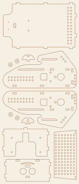
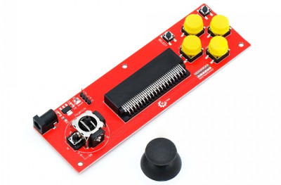

# Sprzęt, połączenia i budowa

## Pliki projektu

- **MakerWorld** – robot *Badger* (Borsuk): <https://makerworld.com/en/models/2668556-badger-robot-for-micro-bit>
  (pliki do cięcia, plik STEP do dalszego rozwoju, STL obudowy pilota)
- **Printables** – obudowa pilota (Handle Joystick for micro:bit, Keyestudio):
  <https://www.printables.com/model/40102-handle-joystick-for-microbit-module-from-keyestudi>
- DXF robota v2 jest też w tym repozytorium: [`hardware/Borsuk_v2.dxf`](../hardware/Borsuk_v2.dxf)

## Lista części (robot v2)

| Część | Ilość | Uwagi |
|---|---|---|
| Sklejka 3 mm | arkusz min. 160 × 370 mm | do cięcia laserem, plik [`Borsuk_v2.dxf`](../hardware/Borsuk_v2.dxf) |
| Klej do drewna | | do sklejenia korpusu |
| BBC micro:bit V1 lub V2 | 1 | V2 zalecany (więcej pamięci, głośnik) |
| Waveshare **Motor Driver for micro:bit** (nr 15220) | 1 | sterownik 2 silników DC + 3 złącza serw |
| Silnik z przekładnią, wał dwustronny (*Dual Shaft Gear Motor*, „żółty TT”) z kołem | 2 | wersja v1: 2 × serwo 360° |
| Czujnik odległości **RCW-0001** | 1 | ultradźwiękowy, TRIG/ECHO, pracuje przy 3,3 V |
| Koszyk na 2 × 18650 (połączenie szeregowe) | 1 | |
| Akumulator Li-ion 18650 | 2 | razem ok. 7,4 V |
| Śruba M3 × 25 | 4 | mocowanie silników |
| Śruba M3 × 10 | 4 | mocowanie sterownika silników |
| Nakrętka M3 | 4 | |
| Przewody | | czujnik ↔ płytka sterownika, zasilanie |

### Pilot (opcjonalnie)

| Część | Ilość | Uwagi |
|---|---|---|
| BBC micro:bit V1 lub V2 | 1 | drugi micro:bit |
| **Keyestudio KS0296** Joystick Breakout Board for micro:bit | 1 | joystick + 6 przycisków, gniazdo DC 4,75–12 V |
| Obudowa z drukarki 3D | 1 | STL na Printables / MakerWorld (linki wyżej) |

## Wycinanie i składanie

- Plik: [`hardware/Borsuk_v2.dxf`](../hardware/Borsuk_v2.dxf), jednostki **mm**, wszystkie
  części na jednym arkuszu **148 × 360 mm**. Podgląd: [`hardware/Borsuk_v2_podglad.svg`](../hardware/Borsuk_v2_podglad.svg).
- Gniazda na wpusty mają **3 × 7 mm**, więc konstrukcja jest pod sklejkę **3 mm**.
  Przy grubszej/cieńszej sklejce przeskaluj gniazda, nie cały rysunek.
- Części: 2 boki (z otworami na silniki i rzędami otworów montażowych), podstawa,
  przód z „buzią” i otworami na czujnik, tył, perforowana płyta górna,
  drobne elementy (podkładki, zaczepy).

Więcej w [`hardware/README.md`](../hardware/README.md).

## Połączenia – robot

micro:bit wkłada się w złącze krawędziowe sterownika Waveshare. Piny są stałe:

| Funkcja | Pin micro:bit |
|---|---|
| Silnik A (lewy) – PWM / IN1 / IN2 | P8 / P13 / P12 |
| Silnik B (prawy) – PWM / IN1 / IN2 | P16 / P14 / P15 |
| Serwo S0 (v1: lewe koło) | P0 |
| Serwo S1 (v1: prawe koło) | P1 |
| Serwo S2 (np. „głowa”, chwytak) | P2 |
| Czujnik odległości TRIG / ECHO | wolne piny złącza płytki rozszerzeń (do uzupełnienia); w bibliotece domyślnie P1 / P2 |

Wolne piny do czujników: P1, P2 (gdy nie używasz S1/S2), P5 i P11 (przyciski A/B),
P19/P20 (I²C), a po wyłączeniu wyświetlacza (`led.enable(false)`) także P3, P4, P6, P7, P9, P10.

### Czujnik odległości RCW-0001

Borsuk używa czujnika **RCW-0001**: działa przy 3,3 V, więc podłącza się go bezpośrednio
do micro:bita, bez dzielnika napięcia. Ma 4 wyprowadzenia: VCC, TRIG, ECHO, GND.
Sygnały TRIG i ECHO podłącz do wolnych pinów na złączu płytki sterownika, a w programie
ustaw te same piny blokiem `czujnik odległości TRIG … ECHO …`
(MicroPython: `robot.set_distance_sensor(trig, echo)`).

> *Do uzupełnienia: numery pinów TRIG/ECHO używane w robotach FabLabu.*

**Uwaga przy zamiennikach:** klasyczny **HC-SR04** wymaga 5 V i oddaje na ECHO sygnał
**5 V**, który może **uszkodzić micro:bita** (wejścia tolerują maks. 3,6 V). Jeśli nie masz
RCW-0001, wybierz **HC-SR04P** lub **RCWL-1601** (oba działają przy 3,3 V), daj dzielnik
napięcia na ECHO (np. 1 kΩ + 2 kΩ) albo użyj czujnika **Grove Ultrasonic Ranger**
(jeden pin sygnałowy – w bloku ustaw TRIG = ECHO).

## Pilot

Pilot to moduł **Keyestudio KS0296 Joystick Breakout Board for micro:bit** w drukowanej
obudowie ([Printables](https://www.printables.com/model/40102-handle-joystick-for-microbit-module-from-keyestudi)).
Dokumentacja producenta: [KS0296 – docs.keyestudio.com](https://docs.keyestudio.com/projects/KS0296/en/latest/docs/KS0296.html).
Poniższy pinout jest z nią zgodny.

| Element | Pin micro:bit |
|---|---|
| Przycisk góra | P10 |
| Przycisk dół | P8 |
| Przycisk lewo | P11 (= przycisk B micro:bita) |
| Przycisk prawo | P9 |
| Select | P7 |
| Mode | P6 |
| Joystick X / Y | P4 / P3 |
| Wciśnięcie joysticka | P5 (= przycisk A micro:bita) |
| Buzzer (jeśli jest w Twojej wersji / obudowie) | P0 |

Piny P3, P4, P6, P7, P9 i P10 są współdzielone z **wyświetlaczem LED** micro:bita,
dlatego biblioteka **wyłącza wyświetlacz** w pilocie. Nie używaj w pilocie bloków
wyświetlacza; zamiast tego używaj dźwięku (buzzer na P0, bloki *Muzyka*).

Na płytce jest też osobne złącze **3V, G, P0, P1** (np. do modułu Bluetooth/UART).
Wejście zasilania: gniazdo DC **4,75–12 V** (stabilizator AMS1117 zasila micro:bita).

## micro:bit V1 a V2

- Obie wersje są obsługiwane (MakeCode kompiluje do obu).
- **V1** potrafi jednocześnie generować PWM tylko na ograniczonej liczbie pinów
  (w praktyce 3). Wystarcza to na 2 silniki + 1 serwo albo 2 serwa kół + 1 serwo.
  Jeśli serwo zaczyna „wariować”, gdy jadą silniki, to właśnie ten limit.
- **V2** gra dźwięk jednocześnie na głośniku i na pinie **P0**. W robocie P0 to serwo S0,
  więc w robocie v1 (serwa kół na S0/S1) nie używaj bloków *Muzyka* – koło by „tańczyło”.
  W pilocie to zaleta: buzzer pilota jest właśnie na P0.

## Zasilanie

- Robot: **2 × 18650 połączone szeregowo** (ok. 7,4 V, do 8,4 V po naładowaniu) do wejścia
  zasilania sterownika Waveshare. Sterownik zasila silniki i micro:bita.
- Używaj ogniw z zabezpieczeniem (PCB) i ładuj je ładowarką do Li-ion. Nie zostawiaj
  robota z włączonym zasilaniem bez nadzoru.
- Gdy robot „resetuje się” przy ruszaniu, akumulatory są rozładowane.
- Pilot można zasilać z USB, z koszyka 2 × AAA micro:bita albo z gniazda DC płytki KS0296 (4,75–12 V).
