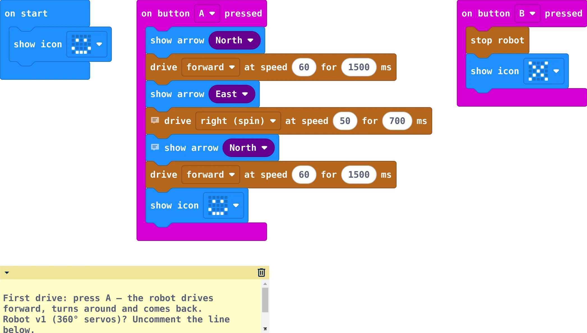
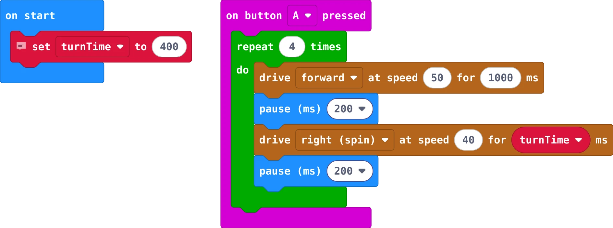
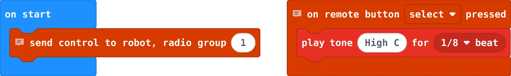
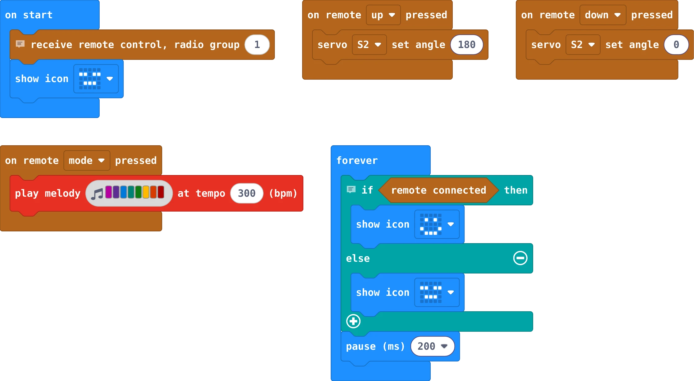
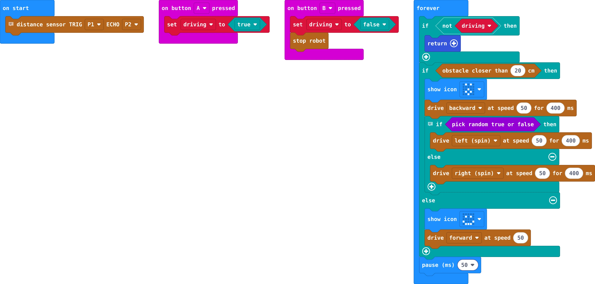
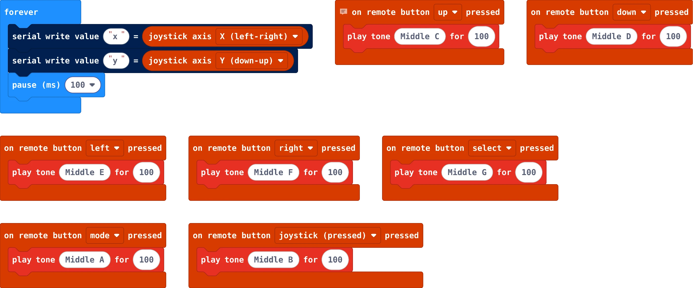
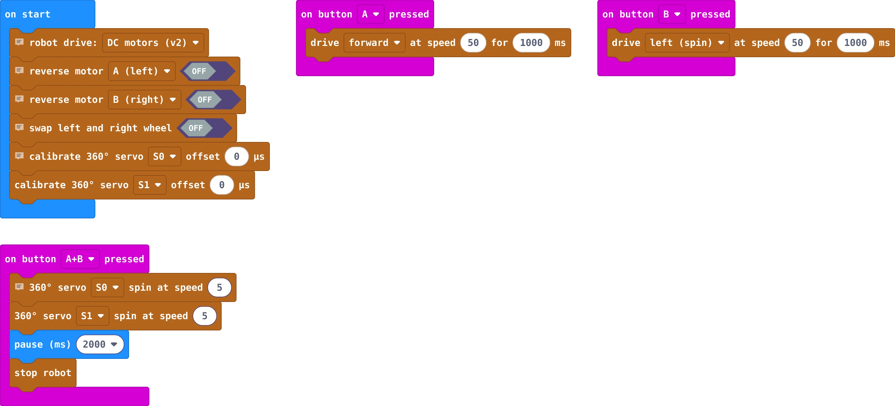
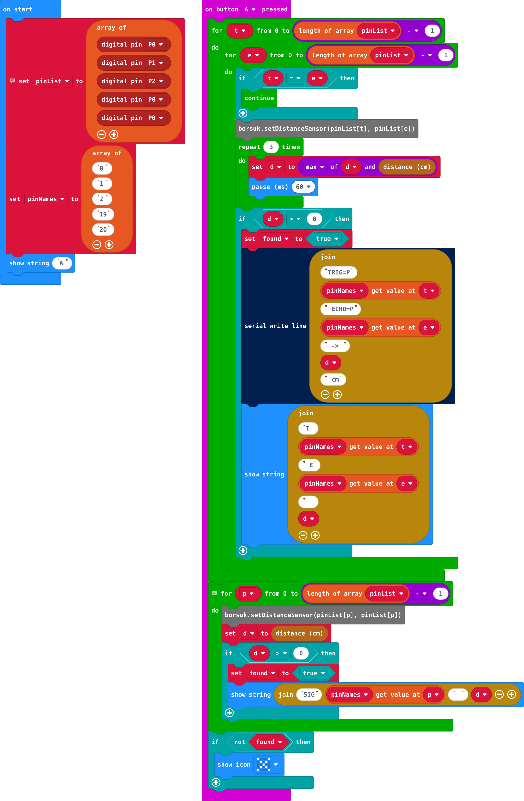

**English** | [Polski](README.pl.md)

# MakeCode examples

To open an example: [makecode.microbit.org](https://makecode.microbit.org) → new project → **Extensions** →
`https://github.com/cyryllo/Borsuk` → switch to **JavaScript** → paste the `.ts` file → switch back to **Blocks**.

Images are generated with [`tools/render_blocks.mjs`](../../tools/render_blocks.mjs).

## [01-first-drive.ts](01-first-drive.ts)

**micro:bit:** robot – A = drive there and back, B = stop

## [02-square.ts](02-square.ts)

**micro:bit:** robot – drive in a square

## [03-remote.ts](03-remote.ts)

**micro:bit:** remote – send joystick and buttons to the robot

## [04-remote-robot.ts](04-remote-robot.ts)

**micro:bit:** robot – remote driving + servo + melody

## [05-obstacle-avoidance.ts](05-obstacle-avoidance.ts)

**micro:bit:** robot – autonomous driving with the distance sensor

## [06-remote-test.ts](06-remote-test.ts)

**micro:bit:** remote – button and joystick test (sound + console)

## [07-calibration.ts](07-calibration.ts)

**micro:bit:** robot – set wheel directions and 360° servos

## [08-find-sensor-pins.ts](08-find-sensor-pins.ts)

**micro:bit:** robot – find which pins the distance sensor is on

