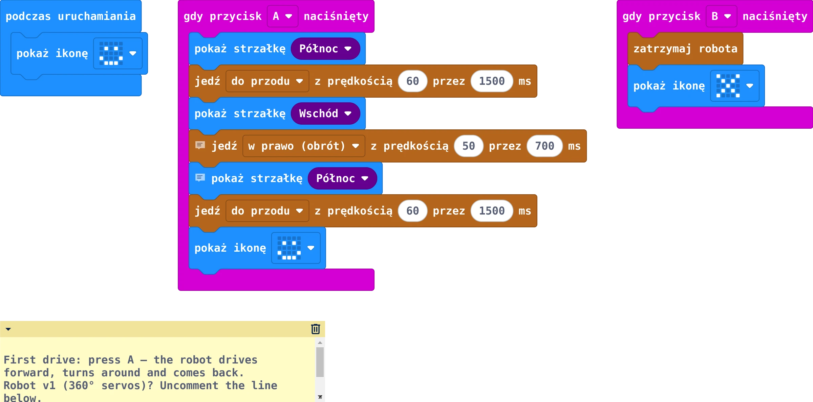
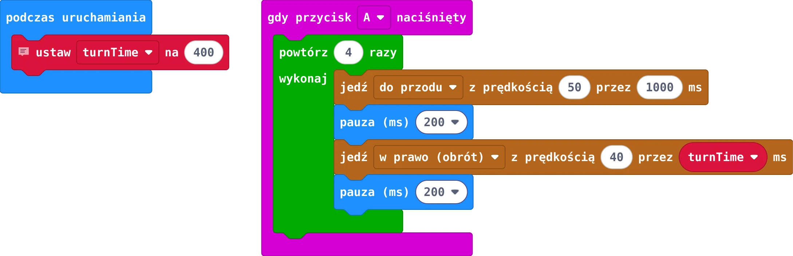
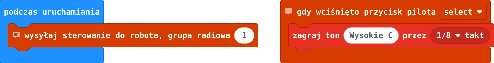
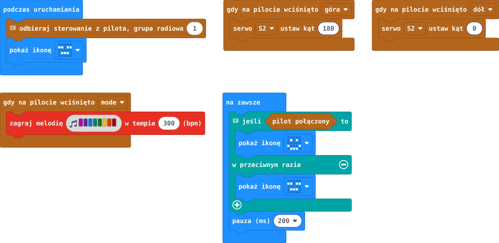
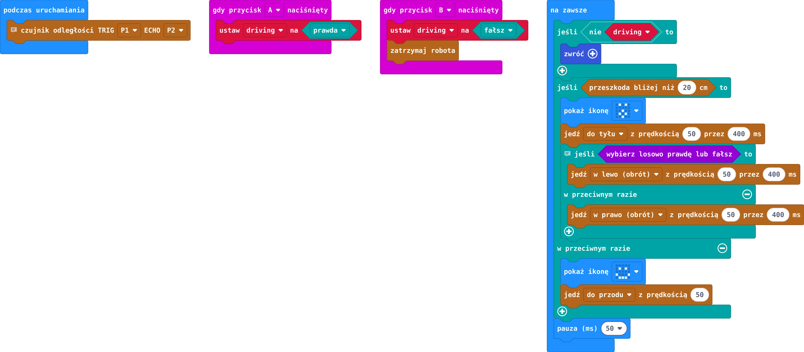
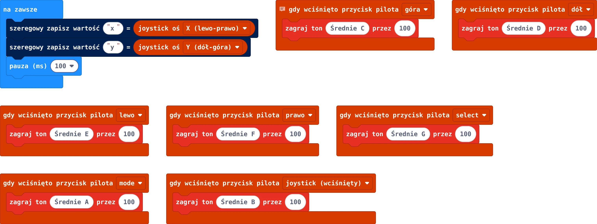
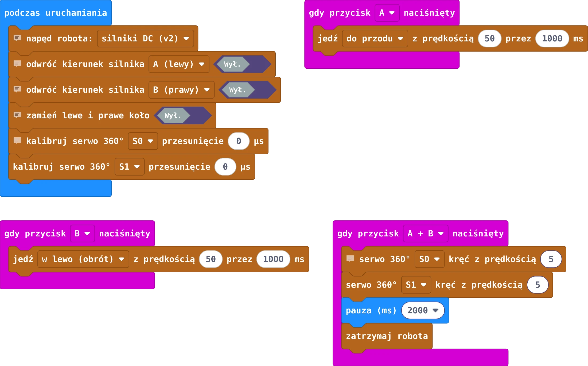
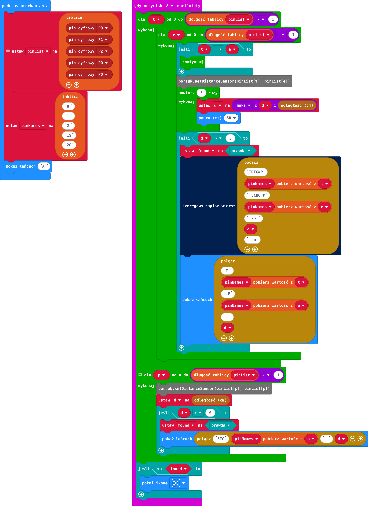

[English](README.md) | **Polski**

# Przykłady MakeCode

Jak otworzyć przykład: [makecode.microbit.org](https://makecode.microbit.org) → nowy projekt → **Rozszerzenia** →
`https://github.com/cyryllo/Borsuk` → przełącz na **JavaScript** → wklej plik `.ts` → wróć do **Bloków**.
Bloki są po polsku, gdy edytor ma ustawiony język polski.

Obrazki generuje skrypt [`tools/render_blocks.mjs`](../../tools/render_blocks.mjs).

## [01-first-drive.ts](01-first-drive.ts)

**micro:bit:** robot – A = przejazd tam i z powrotem, B = stop

## [02-square.ts](02-square.ts)

**micro:bit:** robot – jazda po kwadracie

## [03-remote.ts](03-remote.ts)

**micro:bit:** pilot – wysyłanie joysticka i przycisków do robota

## [04-remote-robot.ts](04-remote-robot.ts)

**micro:bit:** robot – jazda pilotem + serwo + melodia

## [05-obstacle-avoidance.ts](05-obstacle-avoidance.ts)

**micro:bit:** robot – jazda autonomiczna z czujnikiem odległości

## [06-remote-test.ts](06-remote-test.ts)

**micro:bit:** pilot – test przycisków i joysticka (dźwięk + konsola)

## [07-calibration.ts](07-calibration.ts)

**micro:bit:** robot – ustawianie kierunków kół i serw 360°

## [08-find-sensor-pins.ts](08-find-sensor-pins.ts)

**micro:bit:** robot – wykrywanie pinów czujnika odległości

