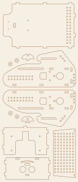
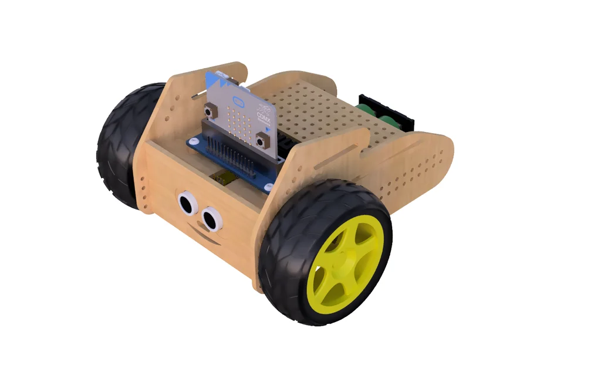

# Konstrukcja – pliki do wycinania

| Plik | Opis |
|---|---|
| [`Borsuk_v2.dxf`](Borsuk_v2.dxf) | wszystkie części robota v2, jednostki **mm**, arkusz **148 × 360 mm** |
| [`Borsuk_v2_podglad.svg`](Borsuk_v2_podglad.svg) | podgląd do oglądania w przeglądarce / na GitHubie (nie do cięcia) |

## Parametry

- Materiał: **sklejka 3 mm** (gniazda na wpusty 3 × 7 mm).
- Otwory montażowe: Ø2,3 i Ø2,4 mm (śruby M2/M2,5 lub wkręty), Ø3 mm.
- Przednia ścianka: dwa otwory Ø14 mm na przetworniki czujnika ultradźwiękowego.
- Wszystkie linie to linie cięcia (warstwa 0).

## Cięcie laserem

- Wczytaj DXF w jednostkach mm (np. LightBurn, MeerK40t, RDWorks) i sprawdź, że
  arkusz ma 148 × 360 mm.
- Najpierw tnij otwory wewnętrzne, potem obrysy (większość programów robi to sama).
- Przed cięciem całości wytnij jeden bok i sprawdź pasowanie wpustu z gniazdem –
  sklejka „3 mm” bywa 2,8–3,2 mm.

## Wizualizacja

## Do uzupełnienia

- [ ] plik projektu CAD (źródłowy, np. Fusion 360 / FreeCAD), jeśli ma być edytowalny
- [ ] DXF wersji v1 (serwa 360°), jeśli różni się od v2
- [ ] instrukcja składania krok po kroku (zdjęcia)
- [ ] dokładna lista śrub i dystansów
