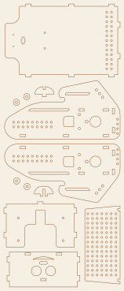
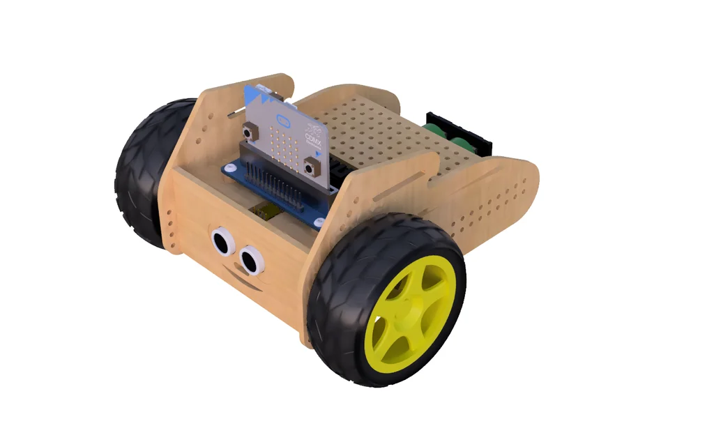

[English](README.md) | **Polski**

# Konstrukcja – pliki do wycinania

| Plik | Opis |
|---|---|
| [`Borsuk_v2.dxf`](Borsuk_v2.dxf) | wszystkie części robota v2, jednostki **mm**, arkusz **148 × 360 mm** |
| [`Borsuk_v2_preview.svg`](Borsuk_v2_preview.svg) | podgląd do oglądania w przeglądarce / na GitHubie (nie do cięcia) |

## Parametry

- Materiał: **sklejka 3 mm** (gniazda na wpusty 3 × 7 mm).
- Otwory montażowe: Ø2,3 i Ø2,4 mm (śruby M2/M2,5 lub wkręty), Ø3 mm.
- Przednia ścianka: dwa otwory Ø14 mm na przetworniki czujnika ultradźwiękowego.
- Wszystkie linie to linie cięcia (warstwa 0).

## Cięcie laserem

- Wczytaj DXF w jednostkach mm (np. [Kerfly](https://github.com/cyryllo/Kerfly), LightBurn, RDWorks)
  i sprawdź, że arkusz ma 148 × 360 mm.
- Najpierw tnij otwory wewnętrzne, potem obrysy (większość programów robi to sama).
- Przed cięciem całości wytnij jeden bok i sprawdź pasowanie wpustu z gniazdem –
  sklejka „3 mm” bywa 2,8–3,2 mm.

## Wizualizacja

## Pozostałe pliki

Na [MakerWorld (Badger robot for micro:bit)](https://makerworld.com/en/models/2668556-badger-robot-for-micro-bit)
jest plik **STEP** (do dalszego rozwoju konstrukcji) i **STL obudowy pilota**.
Obudowa pilota jest też na
[Printables](https://www.printables.com/model/40102-handle-joystick-for-microbit-module-from-keyestudi).

Montaż: silniki 4 × M3 × 25 z nakrętkami, sterownik 4 × M3 × 10, korpus klejony
klejem do drewna. Pełna lista części: [docs/sprzet.md](../docs/pl/sprzet.md).

## Do uzupełnienia

- [ ] instrukcja składania krok po kroku (zdjęcia)
- [ ] DXF wersji v1 (serwa 360°), jeśli różni się od v2
